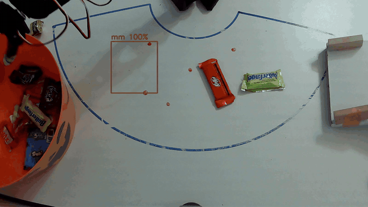

# Candy Sorter

I built a robot arm that sorts Halloween candy. A webcam looks down at the table, a model I trained figures out which of 11 candies it's looking at, and the arm grabs it and drops it in the bucket (Skittles get tossed out the back).



*Sped up 5x. The box is what the model thinks the candy is and how sure it is.*

## How it works

1. **Finding candy.** `detect.py` looks for anything on the table that's colorful, dark, or stands out from the background. It skips the arm's base, the reach outline I drew, and anything the arm can't get to. I also take a photo of the empty table first so the arm stops going after its own shadow (it did that a lot).
2. **Figuring out what it is.** Each candy gets cropped and sent to the classifier in `classify.py`. If it's under 80% sure, the arm leaves it alone.
3. **Pixels to centimeters.** The arm draws its own calibration dots on the table with a marker taped to the gripper, and `pixel_to_arm.py` fits the camera to them. Worst error was 0.13 cm.
4. **Reaching it.** `ik.py` is the inverse kinematics I worked out by hand. It turns "candy at x, y cm" into joint angles, and it checks itself with forward kinematics.
5. **Grabbing it.** For bars like Kit Kats and Twix, the arm turns its wrist to line up with the bar. Soft bags like Skittles and M&Ms were way harder, so for those it opens all the way and squeezes across the diagonal. After closing and again after lifting, it checks the gripper position to make sure it's actually holding something.
6. **Dropping it.** It carries the candy to a spot over the bucket (or behind the arm for Skittles) and lets go. In watch mode it just keeps going as I slide more candy down the ramp.

## The model

- 12 classes: Butterfinger, Haribo, Kit Kat, Life Savers gummies, Milky Way, M&Ms, Nerds Gummy Clusters, Skittles, Smarties, Trolli, Twix, and "nothing" (the shadow, lol)
- 461 crops I took and labeled myself with `collect.py`, all in `dataset/`
- ResNet18 pretrained on ImageNet, with the last block and a new final layer retrained on my candy in `train.py`. Trains on my laptop CPU in a few minutes.
- I held out whole photos for testing, so it never sees almost-identical crops from the same photo in both training and testing
- It got all 114 test crops right, including Twix vs Milky Way (I was worried about those two). That's a small test set though, so it'll still mess up sometimes on a messy table.

## Hardware

- SO-101 follower arm on [LeRobot](https://github.com/huggingface/lerobot) 0.6.1
- A 1080p webcam taped up overhead
- My laptop, no GPU
- A wooden ramp to slide candy in (budgeting 😅) and rubber bands on the gripper fingers

## Running it

I used Python 3.12:

```bash
python -m venv .venv
.venv\Scripts\activate
pip install "lerobot[feetech]==0.6.1" torch torchvision opencv-python pillow numpy
```

Put your port and robot id in `so101_connect.py`. Mine are `COM3` and `snh_follower`.

1. **Calibrate the arm** with LeRobot's `lerobot-calibrate`, using the same robot id.
2. **Record poses** with `python record_pose.py`. Move the arm by hand and save `rest`, `up`, `bin` (over the bucket) and `dump_back` (behind the arm).
3. **Calibrate the camera.** Tape a marker to the gripper and run `python calib_dots.py`. The arm goes to each dot so you can mark it, then takes a photo. Then run `python pixel_to_arm.py` to make `calib.json`.
4. **Collect data** with `python collect.py kitkat`. Spread some of one candy on the table and hit ENTER for each photo. Crops go to `dataset/kitkat/`. Do that for every candy.
5. **Train** with `python train.py`. It shows accuracy every epoch plus a confusion matrix at the end, and saves `candy_model.pt`.
6. **Sort:**
   - `python sort_candy.py --look` labels everything on the table without moving.
   - `python sort_candy.py --watch` keeps sorting until you hit `q`.
   - Add `--empty` to retake the empty-table photo if your lighting changes.

Videos and photos save to `photos/posts/`.

## Stuff that still doesn't work great

- Soft candy bags still slip out sometimes, even with the rubber bands
- The shadow still messes with detection when candy is right next to it
- My webcam only does about 6 fps at 1080p, so I have to speed the videos up

## Files

| File | What it does |
|---|---|
| `sort_candy.py` | The main sorter: look, classify, grab, check, drop |
| `detect.py` | Finds candy in a photo and crops it |
| `classify.py` | Loads the model and labels a crop |
| `train.py` | Trains the model on `dataset/` |
| `collect.py` | Takes photos and saves labeled crops |
| `ik.py` | Inverse and forward kinematics |
| `pixel_to_arm.py`, `calib_dots.py` | Camera calibration |
| `capture.py` | Webcam and video recording |
| `record_pose.py`, `move_pose.py` | Save and replay arm poses |
| `so101_connect.py` | Connects to the arm |

Built with help from Claude Code (see `claudes-contributions.md`).
